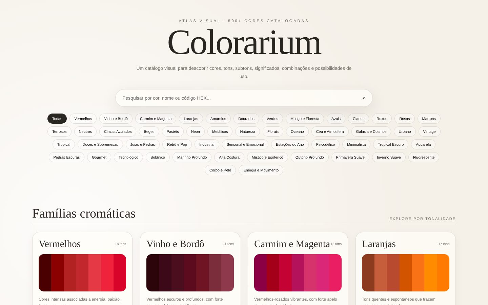

# Colorarium — Guia Visual de Cores

Catálogo interativo com mais de 500 cores organizadas por família e por tema. Para cada cor, o guia mostra os códigos, o significado, onde usar, as combinações, os tons vizinhos, a cor complementar e uma paleta sugerida. Feito para quem trabalha com design, moda, decoração ou identidade visual e precisa escolher cores com critério.

**Demo:** [liviavittoria28-create.github.io/COR](https://liviavittoria28-create.github.io/COR/)

## Funcionalidades

- Busca por nome da cor ou código HEX.
- Filtros por família cromática (vermelhos, azuis, terrosos...) e por tema (oceano, botânico, retrô, inverno suave...).
- Ficha de cada cor: significado, onde usar, com quais cores combina, tons da mesma família, cor complementar e paleta sugerida.

## Tecnologias

HTML, CSS e JavaScript puros, em um único arquivo. A interface é gerada a partir de um conjunto de dados de cores dentro do próprio script. Tipografia com Cormorant Garamond e DM Sans (Google Fonts).

## Como rodar

Abra `index.html` no navegador.

## Autora

Desenvolvido por **Lívia Vittoria** · [GitHub](https://github.com/liviavittoria28-create)
